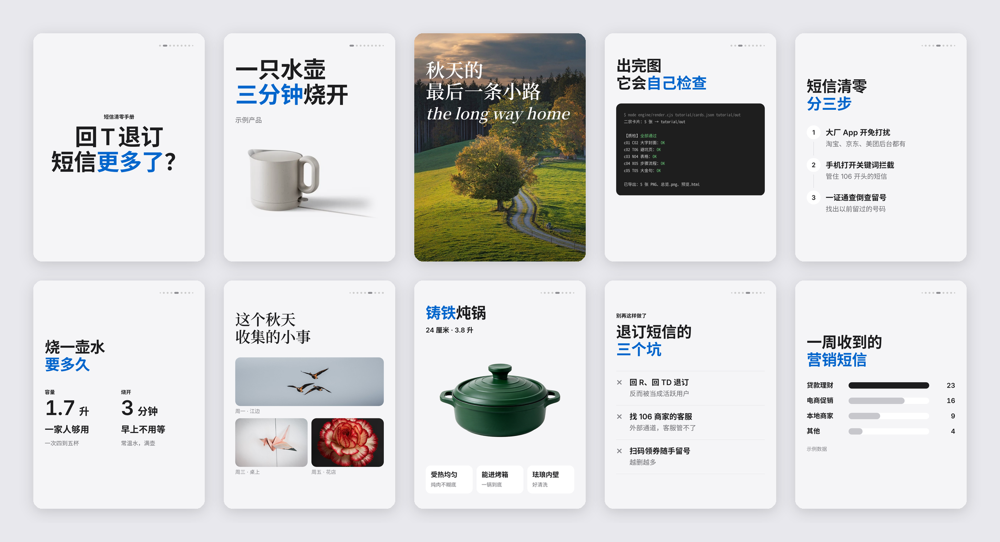
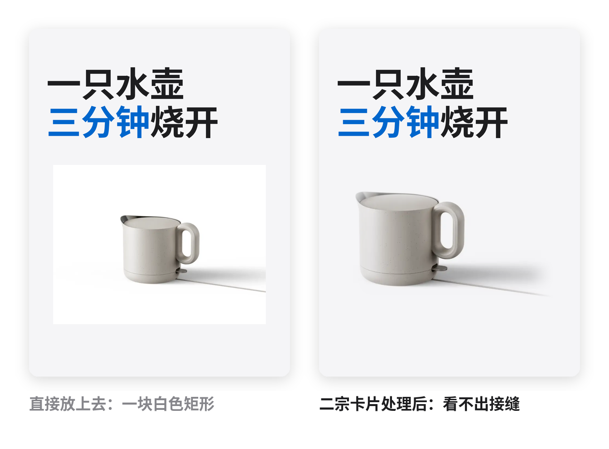
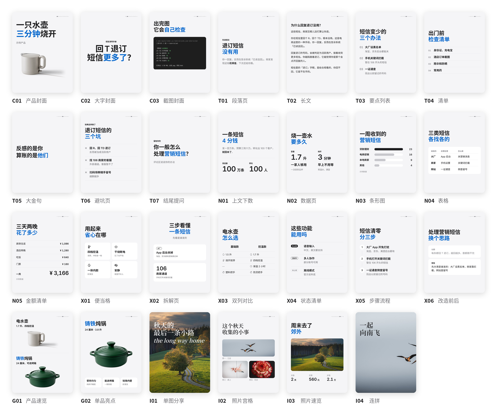
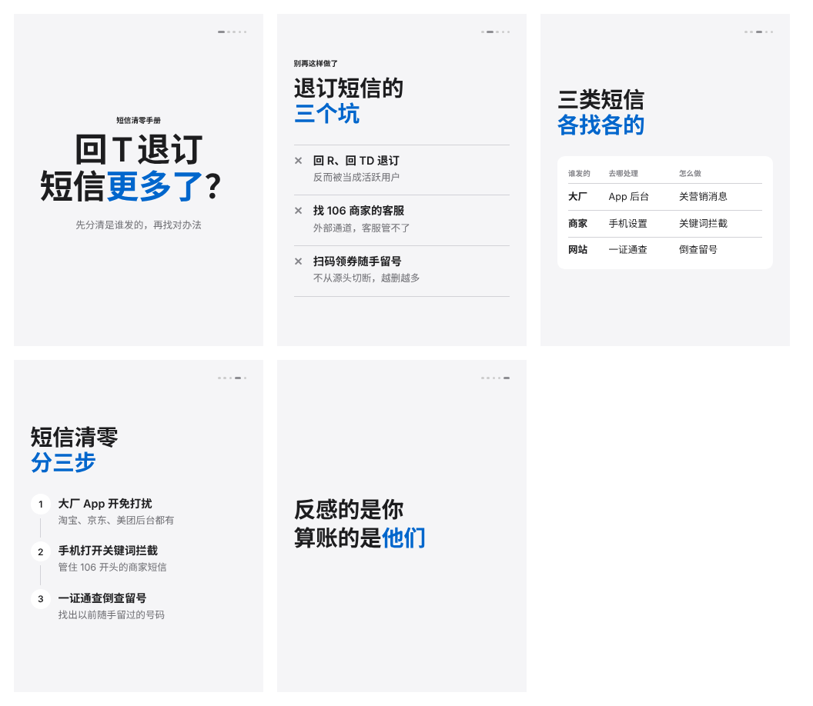
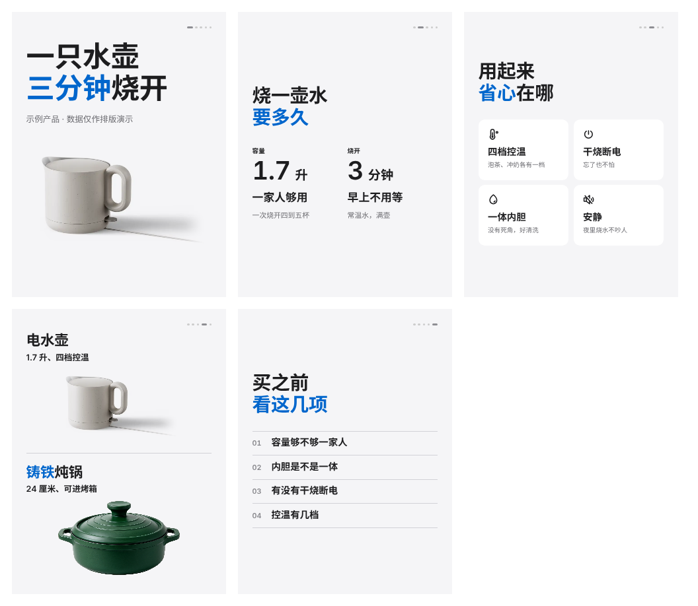
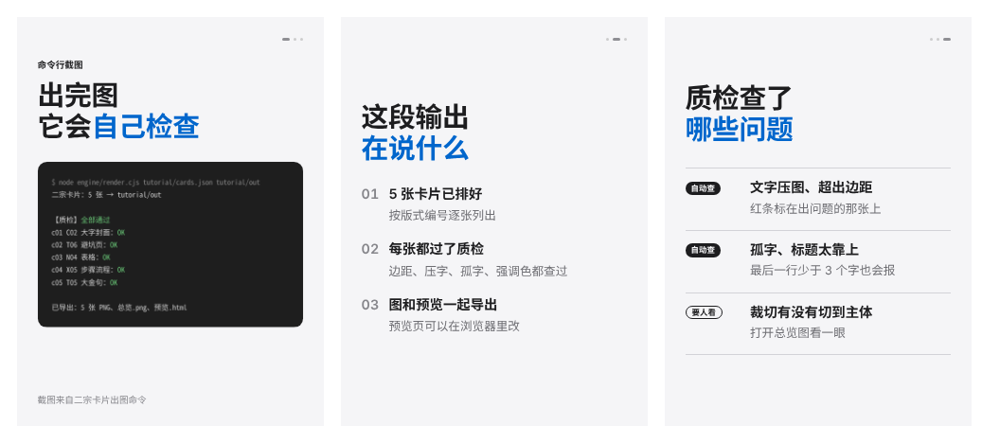

# 二宗卡片 · 苹果风小红书图文 / 公众号贴图


[English](README.en.md)

**把文字排成苹果官网那样干净的卡片。**
你只管写内容，排版、配色、留白交给它：27 个版式自动挑，产品图自动换底，出图后自己检查一遍，不会乱改你一个字。



## 为什么做这个

我想要一套属于自己的卡片。

现在很多卡片 AI 味太重，一页塞的信息太多，读的人注意力聚焦不上去。所以二宗卡片只守一条：**一张卡片只讲一件事**。留白撑场面，颜色只点一下，让读者看完真的记住点什么。

先做给自己用，也开源出来，分享给你。

—— 二宗

## 30 秒开始

把这段话发给你的 AI（Claude Code、Codex 等能运行命令的都可以）：

```text
帮我安装二宗卡片：把 https://github.com/R-Zong/erzong-cards 克隆下来，
把里面的 skills/erzong-cards 文件夹复制到 ~/.claude/skills/erzong-cards，
再进入这个文件夹的 engine 目录运行 npm install。装好后告诉我 SKILL.md 在不在。
```

装好以后，直接这样说：

```text
用二宗卡片，把下面这篇文章做成小红书图文，6 张左右。
把这篇长文原样做成图，一个字都别删。
这是我们新出的水壶（附白底图），做一组产品介绍。
把这张推文截图做成截图解读，第一张只放标题和截图。
这 4 张旅行照片做一组分享，白底，不要翻页圆点。
做一组教程：手机营销短信怎么清零，分三步。
```

它会先给你一张分页清单（几张、每张放什么），你点头了才出图。

## 它好在哪

- ✍️ **不替你改字**：放不下时给建议、给选项，你同意了才改；不凑内容，不加"关注我"。
- 🧩 **27 个版式，自动挑**：封面、要点、步骤、避坑、金句、数据、条形图、表格、算账、对比、改造前后、产品亮点、照片宫格、满版照片、连拼……
- 📖 **长文一个字不删**：要完整读的文章，原文自动分页，段落在句号处断开，小标题不会落在页底。
- 🫧 **产品图看不出接缝**：白底、浅灰底产品图自动换成页面底色，保留产品自己的影子；深色场景图自动渐隐。
- 🔍 **出图后自己检查**：文字压图、超出边距、孤字、内容放不下、标题太靠上、强调色用多了、图片会糊……都会标出来再修。
- 🎛 **一句话换风格**：浅灰 / 纯白底、圆角 / 直角、深色封面、5 种强调色、中文 / 英文。
- 💻 **Windows 双击就能装**：用国内镜像，出图用系统自带的 Edge，不用另外下载浏览器；字体随包，Windows、Mac 出图效果一致。
- 🔒 **在本机出图**：排版和渲染都在你自己的电脑上完成，渲染时不联网。



## 27 个版式

按"这一页要干什么"来分：封面 C、文字 T、数字 N、对比结构 X、产品 G、照片 I。你也可以直接点名："第二页用步骤流程"。



每个版式能放多少字、什么时候用，见 [`references/layouts.md`](skills/erzong-cards/references/layouts.md)。

## 适合谁

- **学生**：课程笔记、考试重点
- **老师**：知识点讲解、课件配图
- **职场人**：项目复盘、年度总结、述职
- **新媒体运营**：产品介绍、测评对比、截图解读
- **生活方式博主**：旅行、探店、穿搭、好物分享（用你自己的照片）

**不太适合**：手账风、重装饰风格、搞笑段子、促销海报。不适合的它会直接告诉你，不硬做。

## 我们守的几条

1. **一张卡片只讲一件事**：一个标题，一个主体，最多一个辅助。
2. **留白撑场面**：内容只占一半左右，空白也是设计。
3. **颜色只点一下**：强调色每页只用一处，通常是标题里的一个词。
4. **字号锁死**：放不下就拆页，不把字缩小。
5. **不替你说话**：不改你的意思，不凑内容，不加引导关注的话。
6. **照片保持原样**：不加滤镜，不改颜色，不加边框。

## 示例

| 教程拆解 | 产品介绍 | 截图解读 | 旅行分享 |
|---|---|---|---|
|  |  |  |  |

内容文件在 `examples/*/cards.json`，单张图在 `examples/*/out/`。

## 安装

技能本体是 `skills/erzong-cards` 这个文件夹。

**1. 放到你用的平台**

| 平台 | 放到哪里 |
|---|---|
| Claude Code | `~/.claude/skills/erzong-cards`（或项目里的 `.claude/skills/`） |
| Claude 网页 / 桌面版 | 把 `skills/erzong-cards` 打成 zip，在设置的技能（Skills）里上传 |
| Codex | `~/.codex/skills/erzong-cards` |
| 其他支持 SKILL.md 的平台（WorkBuddy、千问等） | 放到该平台的技能目录 |

**2. 装出图引擎（只需一次）**

需要 [Node.js](https://nodejs.org)（LTS 版）。

- Windows：双击 `skills/erzong-cards/install/安装.bat`
- Mac / Linux：`bash skills/erzong-cards/install/install.sh`

平台不能运行命令时，可以用简易档：生成一个网页，用浏览器打开后点"下载全部图片"。见 [`references/lite.md`](skills/erzong-cards/references/lite.md)。

## 常见问题

**要会写代码吗？**
不用。装好以后用说话的方式提要求就行。想自己动手的，也可以直接改 `cards.json` 再出图。

**为什么不用 AI 生图？**
AI 生图的字常常是错的，每次结果也不一样。二宗卡片用网页排版出图：字清楚、颜色准、改一个字只动一个字。

**可以商用吗？**
代码以 Apache 2.0 发布，可以商用。随包字体是 SIL OFL，图标是 MIT，都允许商用。示例里的照片只作演示。

**支持英文吗？**
支持。内容文件里写 `"lang": "en"`，行距、字距、标点会按英文的习惯走。

**一次能出几张？**
小红书一篇最多 18 张，建议 9 张以内（公众号图片消息最多 9 张）。超过时它会提醒你。

**和苹果公司有关系吗？**
没有。"苹果风"只借鉴苹果官网排版的留白和克制，不用 Apple 的名字、标志、产品图和字体。

## 接下来

- 更多平台的安装验证（WorkBuddy、千问等）
- 照片页的英文点缀字体
- 第二个主题（暂定偏生活、氛围）

想要什么版式、遇到什么问题，欢迎提 [Issue](../../issues)。

## 致谢

感谢歸藏的 [guizang-social-card-skill](https://github.com/op7418/guizang-social-card-skill)，让我们看到用排版出图的更多可能。二宗卡片走的是另一条路：苹果风的克制排版，面向不懂设计的普通人，自动判断版式。

## 协议

[Apache License 2.0](LICENSE)。随包字体和图标保留各自的协议，见 [NOTICE](NOTICE)。
